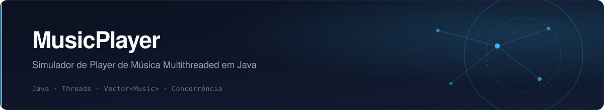

<p align="center">
  
</p>

<p align="center">
  
  
</p>

## Sobre o Projeto

Simulador de **player de música multithreaded** em **Java**, desenvolvido para praticar programação concorrente com `Thread` e coleções sincronizadas (`Vector<Music>`), separando operações de gerenciamento da playlist, reprodução e controle de tempo em threads dedicadas.

## Estrutura do Código (`src/`)

| Classe | Responsabilidade |
| :--- | :--- |
| `MusicPlayer.java` | Classe principal e interface de controle do player |
| `Music.java` | Modelo de faixa musical (`name` e `duration`) |
| `Player.java` | Thread responsável pela reprodução da playlist |
| `Timer.java` | Thread de temporização/progresso da faixa atual |
| `Add.java` | Thread para inserção de novas músicas na lista |
| `Delete.java` | Thread para remoção de músicas por nome |
| `List.java` | Thread para listagem da fila de reprodução |

## Como Executar

```bash
git clone https://github.com/charles-gabriel-cc/MusicPlayer.git
cd MusicPlayer

javac -d out src/*.java
java -cp out MusicPlayer
```

*(Também pode ser aberto diretamente no IntelliJ IDEA usando o projeto configurado em `.idea/`.)*
